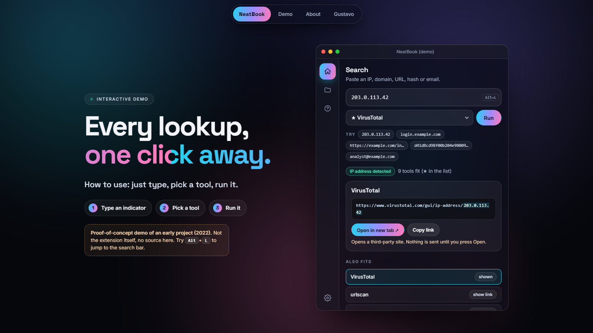
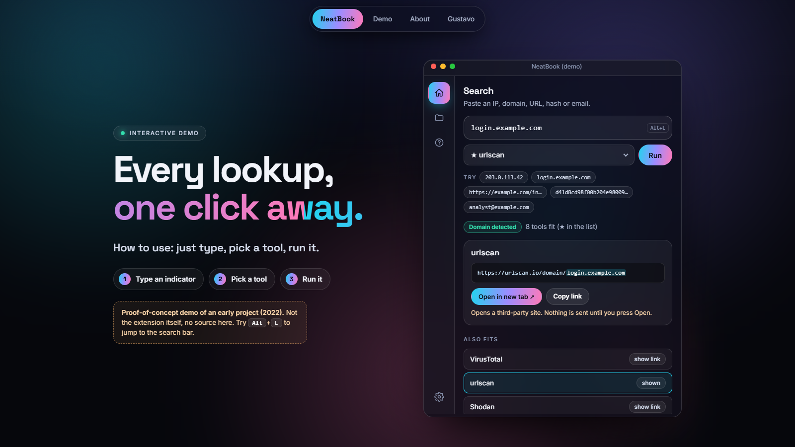

# NEATBOOK TOOLKIT

Type an indicator, pick a tool, run it: every lookup one click away.

**[Live demo](https://tootenramen.github.io/NeatBook-Toolkit/)**

## What you can do

- Paste an IP, domain, URL, hash or email and see it recognised instantly (defanged input like `hxxp://example[.]com` is cleaned up).
- Get the right tools suggested first: reputation, scanning, WHOIS, mail checks.
- See the exact link before anything opens, then open it in a new tab or copy it.
- Manage your own engines in Settings: toggle, reorder, delete, or add one with a `{query}` template.
- Jump to the search bar with Alt+L.

## How it works

This is a browser-only demo of the idea, a proof of concept of an early (2022) project. The original browser extension source is not published here. Everything runs client-side in a single HTML file: indicator detection is plain regex, links are built from public lookup URL patterns, and settings are kept in localStorage. SIEM and ticketing links use placeholder hosts. Sample indicators are fictional (documentation IP ranges, example.com).

**Skills this shows:** security tooling UX, indicator parsing, vanilla JS, accessible interface design.

Built by Gustavo Freitas - [LinkedIn](https://www.linkedin.com/in/gustavo-freitas-69b93910b/) - [more projects](https://github.com/Tootenramen)
